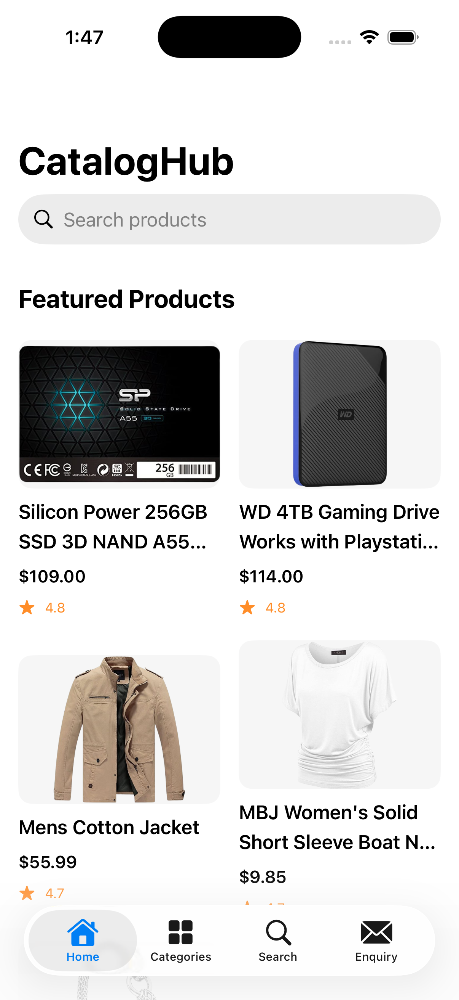

# CatalogHub

A product catalogue application built using **SwiftUI, Swift, Node.js and TypeScript**.

CatalogHub allows users to explore featured products, browse categories, search products, view product details and submit enquiries to the sales team.

## Features

- **Featured Products:** Displays five selected top-rated products.
- **Categories:** Browse products by category.
- **Top Rated Products:** Highlights the five highest-rated products in each category.
- **Search:** Search products using text matching.
- **Product Details:** View product images, descriptions, prices, categories and ratings.
- **Enquiry Form:** Submit customer contact details and product enquiries.
- **Email Notifications:** Backend sends enquiry details to the configured sales inbox.


## Application Screenshots

### Home Screen
Displays five featured products.



### Categories
Displays product categories and top-rated products.


### Search
Displays products matching the search query.


### Product Details
Displays detailed information about the selected product.


### Enquiry
Allows customers to submit product enquiries.


## Technology Stack

### iOS
- Swift
- SwiftUI
- Swift Concurrency (async/await)
- Observation framework
- MVVM
- Repository Pattern
- Dependency Injection
- XCTest
- XCUITest

### Backend
- Node.js
- TypeScript
- Express
- Axios
- Nodemailer
- Fake Store API

## Architecture

The project follows a layered architecture.

```text
iOS Application
    |
    | SwiftUI Views
    |
    | ViewModels
    |
    | Domain Layer
    |
    | Repository Protocols
    |
    | Data Layer
    |
    | APIClient
    |
    | HTTP / JSON
    v
Node.js Backend
    |
    | Express Routes
    |
    | Controllers
    |
    | Services
    |
    | Providers
    |
    +---- Fake Store API
    |
    +---- Email Provider
```

## Project Structure

```text
cataloghub-ios/
├── ios/
│   └── CatalogHub/
├── backend/
│   ├── src/
│   ├── package.json
│   └── tsconfig.json
├── README.md
├── DECISIONS.md
├── AI_USAGE.md
└── .gitignore
```

## Prerequisites

- macOS
- Xcode
- Node.js and npm
- Git

## Running the Backend

Navigate to the backend directory:

```bash
cd backend
```

Install dependencies:

```bash
npm install
```

Configure the required environment variables in a local `.env` file.

Start the development server:

```bash
npm run dev
```

The backend runs locally on:

```text
http://127.0.0.1:3000
```

## Running the iOS Application

1. Open `ios/CatalogHub/CatalogHub.xcodeproj` in Xcode.
2. Select the CatalogHub scheme.
3. Select an iOS Simulator.
4. Ensure the backend is running.
5. Build and run the application.

The simulator is configured to communicate with the local backend at `http://127.0.0.1:3000/`.

## Running Tests

### iOS Unit Tests

Open the project in Xcode and press:

```text
Command + U
```

### UI Tests

Select the `CatalogHubUITests` target and run its test cases through Xcode.

### Backend Build

```bash
cd backend
npm run build
```

## Enquiry Email Configuration

The backend uses Nodemailer to send enquiry notifications.

Configure SMTP credentials and the sales inbox using environment variables.

Never commit `.env` or SMTP credentials to the repository.

## External API

Product catalogue data is retrieved through the backend using the Fake Store API.

The iOS application does not call the external product API directly.

## API Endpoints

| Method | Endpoint | Description |
|---|---|---|
| GET | `/api/products` | Fetch all products |
| GET | `/api/products/featured` | Fetch five featured products |
| GET | `/api/products/:id` | Fetch product details |
| GET | `/api/products/search?q=` | Search products |
| GET | `/api/categories` | Fetch categories |
| GET | `/api/categories/:category/products` | Fetch category products |
| POST | `/api/enquiries` | Submit product enquiry |

## License

This project was created as a technical assignment.
